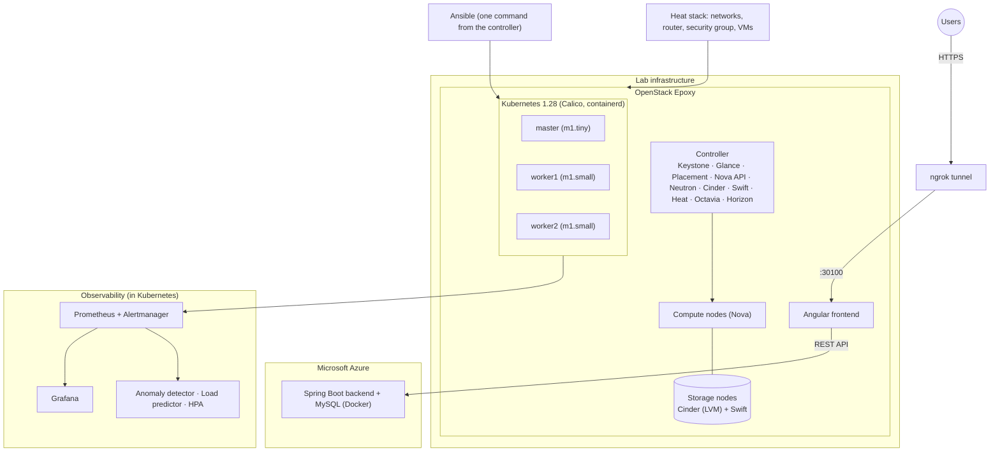
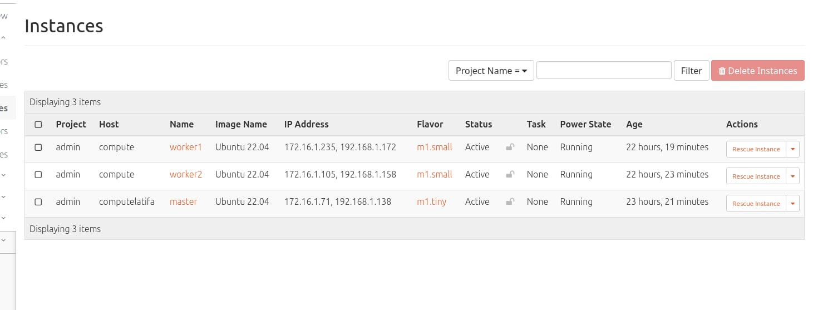
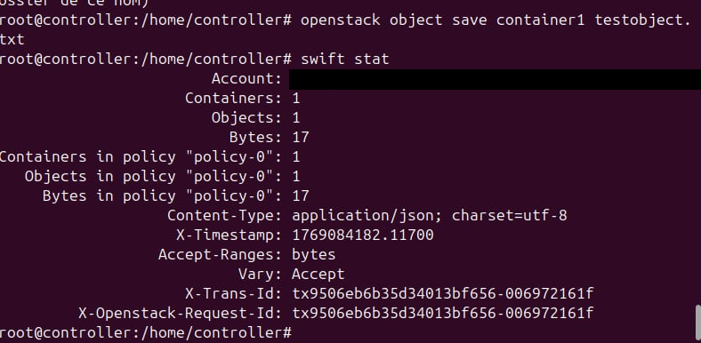
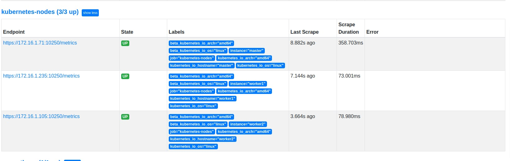
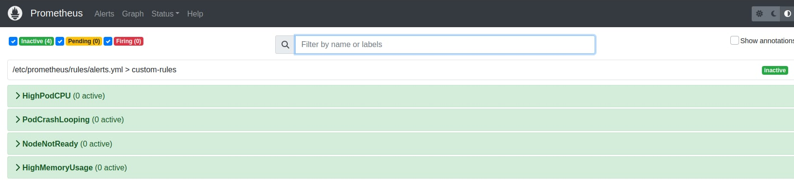
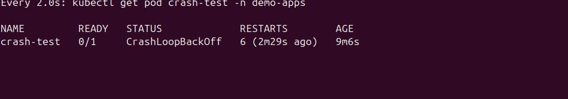
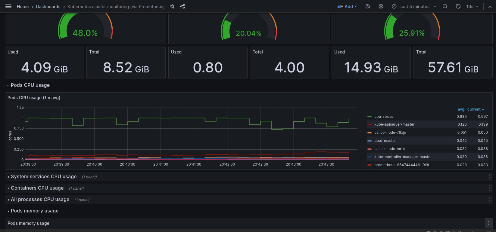
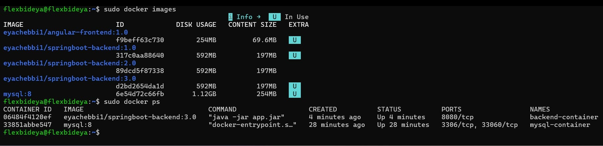
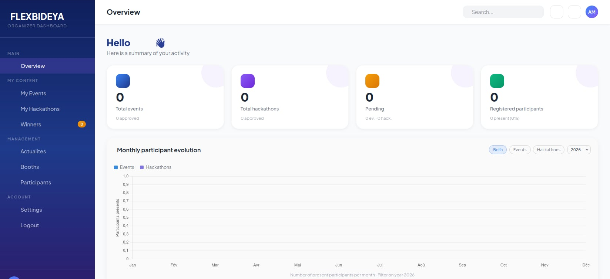
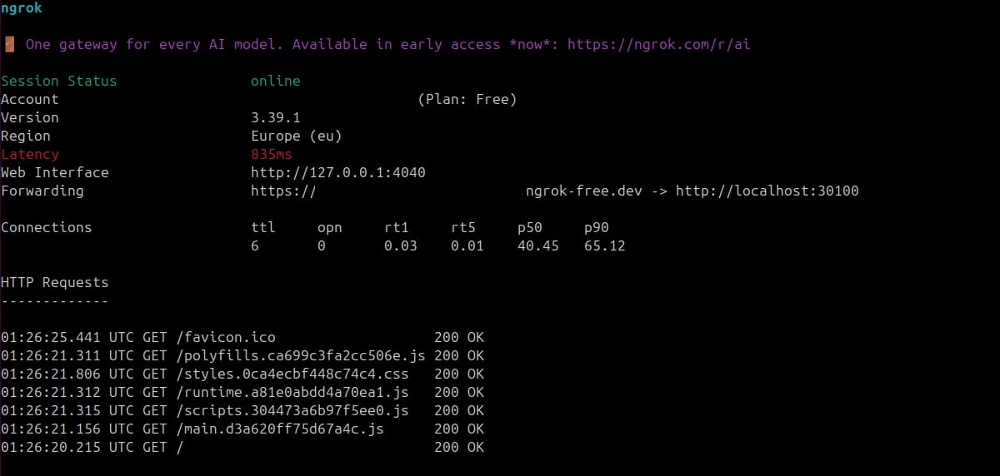

# OpenStack Private Cloud (Epoxy) + Automated Kubernetes Platform

> End-of-year project (4th year, ESPRIT) by a team of 7. A multi-node OpenStack private cloud installed manually from packages, a Kubernetes cluster provisioned automatically with **Heat + Ansible**, observability with **Prometheus/Grafana**, statistical anomaly detection and load prediction, resilience tests, and a hybrid **OpenStack + Azure** deployment driven by **Jenkins**.


## Table of contents
1. [Overview](#1-overview)
2. [Architecture](#2-architecture)
3. [Tech stack](#3-tech-stack)
4. [Project phases](#4-project-phases)
   - [Phase 1 – System design](#phase-1--system-design)
   - [Phase 2 – OpenStack infrastructure](#phase-2--openstack-infrastructure)
   - [Phase 3 – Automation (Heat, Ansible, monitoring)](#phase-3--automation-heat-ansible-monitoring)
   - [Phase 4 – Application development](#phase-4--application-development)
   - [Phase 5 – Deployment and validation](#phase-5--deployment-and-validation)
5. [AI-assisted operations](#5-ai-assisted-operations)
6. [Security](#6-security)
7. [Challenges & troubleshooting](#7-challenges--troubleshooting)
8. [Repository structure](#8-repository-structure)
9. [Roadmap](#9-roadmap)
10. [Authors](#10-authors)

---

## 1. Overview
The goal of the project is a cloud platform that is **fully automated after the initial setup**: no manual step on the Kubernetes nodes once the infrastructure exists.

| Layer | What we built |
|---|---|
| Private cloud | **OpenStack Epoxy** installed manually: Keystone, Glance, Placement, Nova, Neutron (Open vSwitch), Cinder (LVM), Swift, Heat, Octavia, Horizon |
| Infrastructure as code | **Heat** stack: networks, router, security group, instances, floating IPs |
| Configuration | **Ansible** roles and playbooks that build the Kubernetes cluster with a single command |
| Observability | **Prometheus**, Alertmanager, **Grafana**, custom alert rules, a Python anomaly detector and load predictor, **HPA** |
| Resilience | Pod crash, node failure and automatic rescheduling tests |
| Delivery | Docker multi-stage images, **Jenkins** pipeline, hybrid deployment OpenStack + Azure through an **ngrok** tunnel |

> **About the "AI" part.** The anomaly detector uses a statistical method (Z-score against a rolling baseline of 30 measurements) and the load predictor uses a moving average with trend detection. No machine-learning model is trained. TensorFlow was evaluated during Phase 1.


---

## 2. Architecture


### Physical architecture
| Role | Owner | CPU | RAM | Storage | NICs |
|---|---|---|---|---|---|
| Controller | Ons | 8 cores | 32 GB | 100 GB | 2 |
| Compute 1 | Malek | 4 cores | 16 GB | 100 GB | 2 |
| Compute 2 | Latifa | 4 cores | 24 GB | 100 GB | 2 |
| Compute 3 | Malek | 4 cores | 16 GB DDR4 | 200 GB | 2 |
| Compute 4 | Eya | 4 cores | 20 GB | 100 GB | 2 |
| Storage 1 | Tlili | 4 cores | 16 GB | 200 GB | 2 |
| Storage 2 | Aziz | 4 cores | 16 GB | 250 GB | 2 |

### Logical architecture
Application layer → Monitoring (Prometheus & Grafana) → Automation (Ansible) → Orchestration (Kubernetes) → Containerization (Docker) → Cloud infrastructure (OpenStack) → Virtualization → Hypervisor → Hardware.

### Key environment values
| Item | Value |
|---|---|
| OpenStack | Epoxy, manual install on Ubuntu |
| Kubernetes VMs | `master` (m1.tiny), `worker1`, `worker2` (m1.small), Ubuntu 22.04 |
| Kubernetes | 1.28, kubeadm, Calico v3.26, containerd |
| Storage | Cinder volumes (LVM backend), Swift object storage |
| Backend hosting | Microsoft Azure VM (Docker: Spring Boot + MySQL 8) |

---

## 3. Tech stack
| Domain | Technologies |
|---|---|
| Cloud | OpenStack Epoxy, Open vSwitch, Cinder (LVM), Swift, Octavia, Heat |
| Automation | Heat (HOT), Ansible roles, Helm |
| Kubernetes | kubeadm 1.28, containerd, Calico v3.26, metrics-server, HPA |
| App | Spring Boot, Angular, MySQL 8, Ollama |
| Monitoring | Prometheus, Alertmanager, Grafana, node-exporter, kube-state-metrics, Python anomaly detector and load predictor |
| CI/CD & security | Jenkins, Docker multi-stage, RBAC, Secrets, NetworkPolicies, non-root containers |

---

## 4. Project phases

### Phase 1 – System design
We started by listing the requirements of the platform, comparing candidate technologies against each one, and choosing the most suitable technology and version.

| Requirement | Key criteria | Chosen solution |
|---|---|---|
| Virtualization | Compatibility with the infrastructure, live migration, scalability, high-performance workloads | KVM |
| Cloud infrastructure | Open source, modular and multi-tenant, orchestration, private and hybrid deployment, auto-scaling, native load balancer, floating IPs | **OpenStack (Epoxy)** |
| Infrastructure orchestration (IaC) | Readable, versionable templates, resource relationships, floating IPs, volumes | **Heat** |
| Containerization | Resource optimization, portability, industry standard | **Docker** |
| Container orchestration | Declarative configuration, service discovery, load balancing, self-healing | **Kubernetes 1.28** |
| Monitoring & visualization | Real-time metrics, custom dashboards, threshold alerts | **Prometheus + Grafana** |
| Configuration & deployment | Agentless (SSH), simple, open source | **Ansible** |
| Artificial intelligence | Kubernetes deployment support, predictions and optimizations | Evaluated TensorFlow; implemented lightweight Python statistics (see Phase 3) |

**Comparisons carried out**
| Requirement | Compared | Chosen |
|---|---|---|
| Cloud infrastructure | OpenStack vs Proxmox | OpenStack |
| Container orchestration | Kubernetes vs Docker Compose | Kubernetes |
| Configuration management | Ansible vs Puppet | Ansible |

### Phase 2 – OpenStack infrastructure
We built the private cloud by hand, service by service, and configured every node.

1. **Node preparation**: network interfaces, hostnames, packages and storage on the controller, compute and storage nodes (see the physical architecture above).
2. **Controller services**, each installed with the same sequence: database → user → endpoints → configuration → database sync.
   - Identity: **Keystone**
   - Images: **Glance**
   - Scheduling: **Placement**, **Nova** (with etcd, Memcached and the SQL database)
   - Networking: **Neutron** with Open vSwitch
   - Orchestration: **Heat**
   - Load balancing: **Octavia**
   - Dashboard: **Horizon**
3. **Compute nodes**: Nova compute and Neutron agents.
4. **Storage nodes**: **Cinder** (LVM backend) for block storage and **Swift** for object storage.
5. **Networking**: Neutron with Open vSwitch, using **self-service networks** (tenant network `172.16.1.0/24`) on top of a provider network (`192.168.1.0/24`, floating IPs). We added a **router** to keep the IP addressing fixed.

Full procedure and troubleshooting notes: [`docs/openstack-controller-install.md`](docs/openstack-controller-install.md).

### Phase 3 – Automation (Heat, Ansible, monitoring)
We wrote the infrastructure and configuration files so that the cluster builds itself.

**Heat** – [`heat/infrastructure-stack.yaml`](heat/infrastructure-stack.yaml) creates:
- 2 networks (`10.10.0.0/24` frontend, `10.20.0.0/24` backend) and a router with an external gateway;
- 1 security group (SSH, HTTP, HTTPS, ICMP, and MySQL `3306` restricted to the frontend subnet);
- 4 instances (2× Ubuntu 22.04, 2× CirrOS) with ports and floating IPs, key-based SSH only;
- outputs with the floating IPs.

**Ansible** – once the Heat stack has created the VMs, a single `ansible-playbook` command run from the controller configures everything:
- `ansible/site.yml`: modular **roles** (common, containerd, kubernetes, control_plane, calico, workers, cluster_verify, demo_apps, helm).
- `ansible/k8s-ai-monitoring.yml`: complete playbook covering the cluster, Prometheus and Grafana via Helm, the anomaly detector, the load predictor, HPA and the high-availability tests.

**Monitoring and alerting** – alert rules in [`kubernetes/monitoring/custom-alerts.yaml`](kubernetes/monitoring/custom-alerts.yaml): `HighPodCPU`, `PodCrashLooping`, `NodeNotReady`, `HighMemoryUsage`.

**Intelligent operations** (namespace `ai-monitoring`), two Python components deployed on Kubernetes:
- **Anomaly detector**: queries Prometheus every 60 s and flags CPU, memory and restart anomalies (Z-score above 2.5 against a rolling baseline).
- **Load predictor**: estimates the next hour's CPU, memory and network load (moving average and trend) and produces scaling recommendations.

**Autoscaling and availability** – metrics-server and an HPA (target 50% CPU, 1 to 10 replicas), plus a 3-replica application with pod anti-affinity, liveness and readiness probes.

### Phase 4 – Application development
The application (Spring Boot backend, Angular frontend, MySQL, Ollama integration) is developed in a separate repository: `[À COMPLÉTER: link]`.

### Phase 5 – Deployment and validation

**Hybrid deployment (OpenStack + Azure).**
- The Spring Boot backend and MySQL run as Docker containers on Azure.
- The Angular frontend runs on the OpenStack cloud (port `30100` of the Kubernetes master).
- An **ngrok** HTTPS tunnel publishes the frontend and links the two clouds.
- Docker images are built with multi-stage Dockerfiles. A **Jenkins** pipeline (see `jenkins/Jenkinsfile`) automates the build and deployment.

**Reproduce it.**
```bash
# 1. OpenStack ready (see docs/)  2. Create the stack
openstack stack create -t heat/infrastructure-stack.yaml --parameter keypair_name=<your-keypair> --wait infra-stack
openstack stack output show infra-stack --all
# 3. Configure everything with Ansible, from the controller (credentials come from your local .env file, never from the repo)
cd ansible
set -a && source ../.env && set +a
ansible-playbook k8s-ai-monitoring.yml -e vault_grafana_admin_password="$GRAFANA_ADMIN_PASSWORD"
# 4. Failure scenarios
kubectl apply -f ../kubernetes/monitoring/custom-alerts.yaml
kubectl apply -f ../kubernetes/failure-scenarios/crash-test-pod.yaml
kubectl apply -f ../kubernetes/failure-scenarios/cpu-stress-pod.yaml
```

**Validation and demonstrations.**

| Scenario | Result |
|---|---|
| High CPU anomaly | The `cpu-stress` pod pushes CPU to about 1 core, visible in Grafana and detected by the anomaly detector |
| Pod crash | Automatic restart by Kubernetes |
| Node failure | Automatic pod rescheduling `[À COMPLÉTER: add screenshot]` |
| Resource tuning | Recommendations to raise or lower pod CPU and RAM |

**VMs of the Kubernetes cluster running on OpenStack**


**Object storage (Swift)**


**Prometheus scraping the 3 Kubernetes nodes (3/3 up)**


**Custom alert rules loaded in Prometheus**


**Pod crash: Kubernetes keeps restarting it (CrashLoopBackOff, restart counter increasing)**


**Injected CPU anomaly (`cpu-stress`) visible in Grafana**


**Containerized application images (Spring Boot backend, Angular frontend, MySQL)**


**Angular frontend served from the OpenStack cloud**


**ngrok tunnel publishing the frontend (hybrid OpenStack ↔ Azure)**


---

## 5. AI-assisted operations
Two lightweight Python components run in the `ai-monitoring` namespace and read their data from Prometheus. We chose simple statistical methods because they need no training data, run with very few resources and every alert can be explained.

| Component | What it does | How it works |
|---|---|---|
| **Anomaly detector** | Detects abnormal CPU, memory and restart behavior of pods | Every 60 s, compares each pod's current value with a rolling baseline of its last 30 measurements. Above 2.5 standard deviations (Z-score) it raises a `MEDIUM` anomaly, above 3 a `HIGH` one. A high restart rate is flagged `CRITICAL`. |
| **Load predictor** | Estimates next hour's CPU, memory and network load and recommends actions | Every 5 min, a moving average over the history of the next hour, adjusted by the detected trend (increasing, decreasing, stable). It then suggests pre-scaling, checking memory limits or preparing for traffic. |

**Validated scenario**: the injected `cpu-stress` pod pushes CPU to about 1 core, the spike is visible in Grafana and the detector reports it.

**Current limits**
- No machine-learning model is trained.
- Results are written to the pod logs and to a JSON file, and are not yet sent to Alertmanager.
- Response-time anomalies are not implemented (the function is a placeholder).

**Next step**: send detector alerts to Alertmanager, then compare the statistical approach with a trained model (for example Isolation Forest for anomalies, Prophet for load).

---

## 6. Security
Security was considered at each layer, from the cloud to the containers.

| Layer | Measure |
|---|---|
| Network (OpenStack) | Heat security group opens only SSH, HTTP, HTTPS and ICMP, and restricts MySQL (`3306`) to the frontend subnet. Custom firewall rules on top. |
| Access to instances | Key-based SSH only, no password login. |
| Identity | Keystone for authentication and authorization between OpenStack services. |
| Kubernetes | RBAC, Kubernetes Secrets, NetworkPolicies, non-root containers. |
| Secrets | All passwords and credentials are stored in environment files (`.env`), never hard-coded in playbooks, manifests or source code. The SSH private key stays on the machine that runs Ansible. |
| Containers | Docker multi-stage builds, so build tools stay out of the final images. |

### Known limitations and planned improvements
We list them because a platform is only as secure as its weakest point.

| Limitation | Improvement |
|---|---|
| Prometheus, Grafana and Alertmanager are exposed with NodePort (`30090`, `30080`, `30093`) without TLS | Put them behind an Ingress with TLS and authentication |
| The frontend is published through a public ngrok HTTPS tunnel | Replace it with a controlled entry point (reverse proxy or VPN) |
| Metrics-server runs with `--kubelet-insecure-tls` in the lab | Use valid kubelet certificates |
| Docker images are not scanned | Add an image scan (for example Trivy) to the Jenkins pipeline |
| A single controller is a single point of failure | Highly available controller |

---

## 7. Challenges & troubleshooting
Each entry follows the same format (symptom, cause, fix) so that it can be reused as a runbook.

### Controller lost external connectivity after Octavia setup
- **Symptom**: the controller could no longer reach the outside network after the Octavia configuration.
- **Cause**: a default route was injected on the `o-bhm0` interface.
- **Fix**: removed the route and added a `dhclient` hook that ignores routers on that interface.

### Octavia could not use the amphora image
- **Symptom**: load balancer creation failed because the amphora image was not usable.
- **Cause**: the image owner did not match the project ID set in the configuration.
- **Fix**: aligned the project ID in the configuration with the image owner.

### Instance scheduling failed even though the hardware was sufficient
- **Symptom**: launching instances failed because the scheduler could not pick a compute node to run them on.
- **Diagnosis**: the physical resources of the nodes were adequate, so we investigated further. After several tests, the limit turned out to be the CPU available to the Nova service.
- **Cause**: not enough CPU for Nova.
- **Fix**: increased the CPU allocated to the Nova compute node.

### Nova compute could not use KVM
- **Symptom**: instances could not run with hardware virtualization on a compute node. `[À COMPLÉTER: exact error from nova-compute.log]`
- **Diagnosis**: checked that the KVM modules were loaded, the CPU vendor, the permissions on `/dev/kvm`, the `[libvirt]` section of the Nova configuration, and the Nova compute logs.
```bash
lsmod | grep kvm                                   # KVM modules loaded?
lscpu | grep -i vendor                             # Intel or AMD
sudo modprobe kvm_intel                            # or kvm_amd, if the module is missing
ls -l /dev/kvm                                     # permissions on the device
sudo qemu-system-x86_64 -enable-kvm -version       # can QEMU use KVM?
sudo grep -A 5 "\[libvirt\]" /etc/nova/nova-compute.conf   # expected: virt_type = kvm
sudo tail -30 /var/log/nova/nova-compute.log       # errors
```
- **Cause**: the `nova` user did not have access to `/dev/kvm`.
- **Fix**: added `nova` to the `kvm` group, restarted the service and checked the logs.
```bash
sudo usermod -a -G kvm nova
groups nova                                        # nova must appear in the kvm group
ls -l /dev/kvm
sudo systemctl restart nova-compute
sudo systemctl status nova-compute
sudo tail -f /var/log/nova/nova-compute.log        # no more errors
```

### Docker Desktop made the virtual machines unstable
- **Symptom**: installing Docker Desktop broke the machines.
- **Cause**: Docker Desktop relies on virtualization, which conflicted with the virtualization already used by the lab.
- **Fix**: uninstalled Docker Desktop and kept only Docker Engine installed directly on Ubuntu.

### Neutron metadata agent missing
- **Symptom**: after installing the Neutron agents, the agent list showed the L2 agent (layer-2 connectivity and virtual switch configuration), the L3 agent (routing and NAT) and the DHCP agent (automatic IP assignment), but not the metadata agent, which passes initialization metadata to instances.
- **Investigation**: we read the OpenStack documentation on the metadata service, which explains how an instance retrieves its SSH key, cloud-init scripts and user data through the link-local address `169.254.169.254` ([Metadata Service Support](https://docs.openstack.org/developer/dragonflow/specs/metadata_service.html)).
- **Cause**: the agent did not appear in our deployment, and it did not block the deployment.
- **Fix**: none needed.

### Instances shown as Running but not working after deployment
- **Symptom**: some time after the application deployment phase, the instances were in the `Running` state but did not work correctly.
- **Cause**: the database image was not compatible with the instance image.
- **Fix**: rebooting the machine.

### Ansible could not open SSH sessions on the instances
- **Symptom**: the Ansible playbook could not run on the instances.
- **Cause**: the private key of the keypair was not present on the machine running Ansible.
- **Fix**: copied the private key onto that machine. Never commit this key to the repository.

### Frontend still calling the old backend after a change
- **Symptom**: on the Angular frontend served by Kubernetes (NodePort `30100`), account creation failed with `Http failure response for http://<backend-ip>:8080/api/auth/signup: 0 Unknown Error`.
- **Cause**: the modifications made to the application image were not applied to the cluster, so the pods kept running the previous version.
- **Fix**: rebuilt the image, updated the deployment and restarted the rollout, then checked that the pods ran the new image.
```bash
kubectl set image deployment/<frontend> <container>=<image>:<new-tag>
kubectl rollout restart deployment/<frontend>
kubectl rollout status deployment/<frontend>
kubectl describe pod <pod> | grep Image            # confirm the new image is running
```

---

## 8. Repository structure
```
.
├── README.md
├── ansible/
│   ├── ansible.cfg · site.yml · k8s-ai-monitoring.yml
│   ├── inventory/hosts.ini · group_vars/all.yml
│   └── roles/ (common, containerd, kubernetes, control_plane, calico, workers, cluster_verify, demo_apps, helm)
├── heat/infrastructure-stack.yaml
├── kubernetes/           # alert rules, failure scenarios (+ app manifests)
├── docker/               # Dockerfiles (multi-stage)
├── jenkins/              # Jenkinsfile
└── docs/
    ├── openstack-controller-install.md
    └── images/
```


## 10. Authors
Team of 7 (4th year, ESPRIT): Ons Ghariani, Malek, Latifa, Eya, Tlili, Aziz.
**Ons Ghariani**: [LinkedIn](https://www.linkedin.com/in/ons-ghariani-266103262) · [GitHub](https://github.com/ons-ghariani18)
