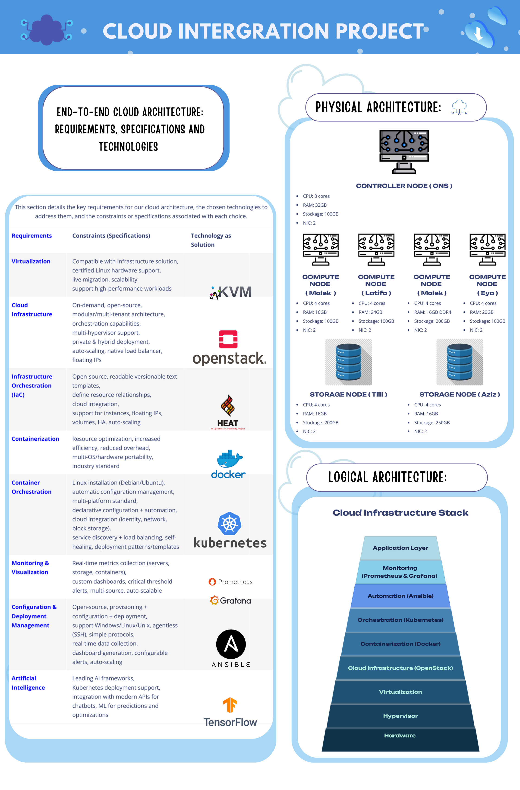
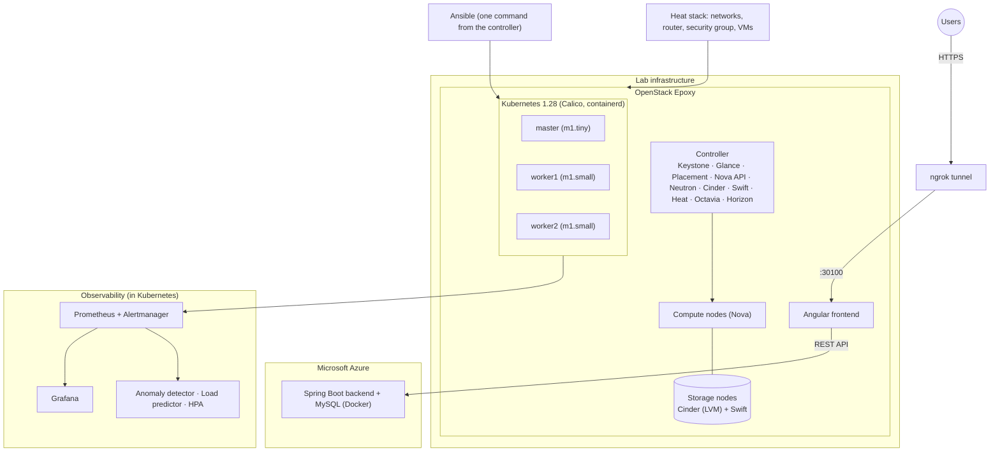

# OpenStack Private Cloud (Epoxy) + Automated Kubernetes Platform

> End-of-year project (4th year, ESPRIT) by a team of 6. A multi-node OpenStack private cloud installed manually from packages, a Kubernetes cluster provisioned automatically with **Heat + Ansible**, observability with **Prometheus/Grafana**, statistical anomaly detection and load prediction, resilience tests, and a hybrid **OpenStack + Azure** deployment driven by **Jenkins**.


## Table of contents
1. [Overview](#1-overview)
2. [Architecture](#2-architecture)
3. [Tech stack](#3-tech-stack)
4. [Project phases](#4-project-phases)
   - [Phase 1 – System design](#phase-1--system-design)
   - [Phase 2 – OpenStack infrastructure](#phase-2--openstack-infrastructure)
   - [Phase 3 – Automation (Heat, Ansible, monitoring)](#phase-3--automation-heat-ansible-monitoring)
   - [Phase 4 – Application development](#phase-4--application-development)
   - [Phase 5 – Deployment and validation](#phase-5--deployment-and-validation)
5. [Challenges & troubleshooting](#5-challenges--troubleshooting)
6. [Repository structure](#6-repository-structure)
7. [Roadmap](#7-roadmap)
8. [Authors](#8-authors)

---

## 1. Overview
The goal of the project is a cloud platform that is **fully automated after the initial setup**: no manual step on the Kubernetes nodes once the infrastructure exists.

| Layer | What we built |
|---|---|
| Private cloud | **OpenStack Epoxy** installed manually: Keystone, Glance, Placement, Nova, Neutron (Open vSwitch), Cinder (LVM), Swift, Heat, Octavia, Horizon |
| Infrastructure as code | **Heat** stack: networks, router, security group, instances, floating IPs |
| Configuration | **Ansible** roles and playbooks that build the Kubernetes cluster with a single command |
| Observability | **Prometheus**, Alertmanager, **Grafana**, custom alert rules, a Python anomaly detector and load predictor, **HPA** |
| Resilience | Pod crash, node failure and automatic rescheduling tests |
| Delivery | Docker multi-stage images, **Jenkins** pipeline, hybrid deployment OpenStack + Azure through an **ngrok** tunnel |

> **About the "AI" part.** The anomaly detector uses a statistical method (Z-score against a rolling baseline of 30 measurements) and the load predictor uses a moving average with trend detection. No machine-learning model is trained. TensorFlow was evaluated during Phase 1.



---

## 2. Architecture


### Physical architecture
<!-- TODO: confirm the number of compute nodes (poster: 4, previous README: 6) and the controller specs -->
| Role | Owner | CPU | RAM | Storage | NICs |
|---|---|---|---|---|---|
| Controller | Ons | 8 cores | 32 GB | 100 GB | 2 |
| Compute 1 | Malek | 4 cores | 16 GB | 100 GB | 2 |
| Compute 2 | Latifa | 4 cores | 24 GB | 100 GB | 2 |
| Compute 3 | Malek | 4 cores | 16 GB DDR4 | 200 GB | 2 |
| Compute 4 | Eya | 4 cores | 20 GB | 100 GB | 2 |
| Storage 1 | Tlili | 4 cores | 16 GB | 200 GB | 2 |
| Storage 2 | Aziz | 4 cores | 16 GB | 250 GB | 2 |

### Logical architecture
Application layer → Monitoring (Prometheus & Grafana) → Automation (Ansible) → Orchestration (Kubernetes) → Containerization (Docker) → Cloud infrastructure (OpenStack) → Virtualization → Hypervisor → Hardware.

### Key environment values
| Item | Value |
|---|---|
| OpenStack | Epoxy, manual install on Ubuntu |
| Kubernetes VMs | `master` (m1.tiny), `worker1`, `worker2` (m1.small), Ubuntu 22.04 |
| Kubernetes | 1.28, kubeadm, Calico v3.26, containerd |
| Storage | Cinder volumes (LVM backend), Swift object storage |
| Backend hosting | Microsoft Azure VM (Docker: Spring Boot + MySQL 8) |

---

## 3. Tech stack
| Domain | Technologies |
|---|---|
| Cloud | OpenStack Epoxy, Open vSwitch, Cinder (LVM), Swift, Octavia, Heat |
| Automation | Heat (HOT), Ansible roles, Helm |
| Kubernetes | kubeadm 1.28, containerd, Calico v3.26, metrics-server, HPA |
| App | Spring Boot, Angular, MySQL 8, Ollama |
| Monitoring | Prometheus, Alertmanager, Grafana, node-exporter, kube-state-metrics, Python anomaly detector and load predictor |
| CI/CD & security | Jenkins, Docker multi-stage, RBAC, Secrets, NetworkPolicies, non-root containers |

---

## 4. Project phases

### Phase 1 – System design
We started by listing the requirements of the platform, comparing candidate technologies against each one, and choosing the most suitable technology and version.

| Requirement | Key criteria | Chosen solution |
|---|---|---|
| Virtualization | Compatibility with the infrastructure, live migration, scalability, high-performance workloads | KVM |
| Cloud infrastructure | Open source, modular and multi-tenant, orchestration, private and hybrid deployment, auto-scaling, native load balancer, floating IPs | **OpenStack (Epoxy)** |
| Infrastructure orchestration (IaC) | Readable, versionable templates, resource relationships, floating IPs, volumes | **Heat** |
| Containerization | Resource optimization, portability, industry standard | **Docker** |
| Container orchestration | Declarative configuration, service discovery, load balancing, self-healing | **Kubernetes 1.28** |
| Monitoring & visualization | Real-time metrics, custom dashboards, threshold alerts | **Prometheus + Grafana** |
| Configuration & deployment | Agentless (SSH), simple, open source | **Ansible** |
| Artificial intelligence | Kubernetes deployment support, predictions and optimizations | Evaluated TensorFlow; implemented lightweight Python statistics (see Phase 3) |

Alternatives considered for each requirement: `[À COMPLÉTER]`

### Phase 2 – OpenStack infrastructure
We built the private cloud by hand, service by service, and configured every node.

1. **Node preparation**: network interfaces, hostnames, packages and storage on the controller, compute and storage nodes (see the physical architecture above).
2. **Controller services**, each installed with the same sequence: database → user → endpoints → configuration → database sync.
   - Identity: **Keystone**
   - Images: **Glance**
   - Scheduling: **Placement**, **Nova** (with etcd, Memcached and the SQL database)
   - Networking: **Neutron** with Open vSwitch
   - Orchestration: **Heat**
   - Load balancing: **Octavia**
   - Dashboard: **Horizon**
3. **Compute nodes**: Nova compute and Neutron agents.
4. **Storage nodes**: **Cinder** (LVM backend) for block storage and **Swift** for object storage.
5. **Networking**: `[À COMPLÉTER: provider networks and/or self-service networks, subnets used]`

Full procedure and troubleshooting notes: [`docs/openstack-controller-install.md`](docs/openstack-controller-install.md).

### Phase 3 – Automation (Heat, Ansible, monitoring)
We wrote the infrastructure and configuration files so that the cluster builds itself.

**Heat** – [`heat/infrastructure-stack.yaml`](heat/infrastructure-stack.yaml) creates:
- 2 networks (`10.10.0.0/24` frontend, `10.20.0.0/24` backend) and a router with an external gateway;
- 1 security group (SSH, HTTP, HTTPS, ICMP, and MySQL `3306` restricted to the frontend subnet);
- 4 instances (2× Ubuntu 22.04, 2× CirrOS) with ports and floating IPs, key-based SSH only;
- outputs with the floating IPs.

**Ansible** – once the Heat stack has created the VMs, a single `ansible-playbook` command run from the controller configures everything:
- `ansible/site.yml`: modular **roles** (common, containerd, kubernetes, control_plane, calico, workers, cluster_verify, demo_apps, helm).
- `ansible/k8s-ai-monitoring.yml`: complete playbook covering the cluster, Prometheus and Grafana via Helm, the anomaly detector, the load predictor, HPA and the high-availability tests.

**Monitoring and alerting** – alert rules in [`kubernetes/monitoring/custom-alerts.yaml`](kubernetes/monitoring/custom-alerts.yaml): `HighPodCPU`, `PodCrashLooping`, `NodeNotReady`, `HighMemoryUsage`.

**Intelligent operations** (namespace `ai-monitoring`), two Python components deployed on Kubernetes:
- **Anomaly detector**: queries Prometheus every 60 s and flags CPU, memory and restart anomalies (Z-score above 2.5 against a rolling baseline).
- **Load predictor**: estimates the next hour's CPU, memory and network load (moving average and trend) and produces scaling recommendations.

**Autoscaling and availability** – metrics-server and an HPA (target 50% CPU, 1 to 10 replicas), plus a 3-replica application with pod anti-affinity, liveness and readiness probes.

### Phase 4 – Application development
The application (Spring Boot backend, Angular frontend, MySQL, Ollama integration) is developed in a separate repository: `[À COMPLÉTER: link]`.

### Phase 5 – Deployment and validation

**Hybrid deployment (OpenStack + Azure).**
- The Spring Boot backend and MySQL run as Docker containers on Azure.
- The Angular frontend runs on the OpenStack cloud (port `30100` of the Kubernetes master).
- An **ngrok** HTTPS tunnel publishes the frontend and links the two clouds.
- Docker images are built with multi-stage Dockerfiles. A **Jenkins** pipeline (see `jenkins/Jenkinsfile`) automates the build and deployment.

**Reproduce it.**
```bash
# 1. OpenStack ready (see docs/)  2. Create the stack
openstack stack create -t heat/infrastructure-stack.yaml --parameter keypair_name=<your-keypair> --wait infra-stack
openstack stack output show infra-stack --all
# 3. Configure everything with Ansible, from the controller (password is never stored in the repo)
cd ansible
ansible-playbook k8s-ai-monitoring.yml -e vault_grafana_admin_password='<YOUR_PASSWORD>'
# 4. Failure scenarios
kubectl apply -f ../kubernetes/monitoring/custom-alerts.yaml
kubectl apply -f ../kubernetes/failure-scenarios/crash-test-pod.yaml
kubectl apply -f ../kubernetes/failure-scenarios/cpu-stress-pod.yaml
```

**Validation and demonstrations.**

| Scenario | Result |
|---|---|
| High CPU anomaly | The `cpu-stress` pod pushes CPU to about 1 core, visible in Grafana and detected by the anomaly detector |
| Pod crash | Automatic restart by Kubernetes |
| Node failure | Automatic pod rescheduling `[À COMPLÉTER: add screenshot]` |
| Resource tuning | Recommendations to raise or lower pod CPU and RAM |

**VMs of the Kubernetes cluster running on OpenStack**


**Object storage (Swift)**


**Prometheus scraping the 3 Kubernetes nodes (3/3 up)**


**Custom alert rules loaded in Prometheus**


**Pod crash: Kubernetes keeps restarting it (CrashLoopBackOff, restart counter increasing)**


**Injected CPU anomaly (`cpu-stress`) visible in Grafana**


**Containerized application images (Spring Boot backend, Angular frontend, MySQL)**


**Angular frontend served from the OpenStack cloud**


**ngrok tunnel publishing the frontend (hybrid OpenStack ↔ Azure)**


---

## 5. Challenges & troubleshooting
Each entry follows the same format so that it can be reused as a runbook.

### Controller lost external connectivity after Octavia setup
- **Symptom**: the controller could no longer reach the outside network after the Octavia configuration.
- **Cause**: a default route was injected on the `o-bhm0` interface.
- **Fix**: removed the route and added a `dhclient` hook that ignores routers on that interface.

### Octavia could not use the amphora image
- **Symptom**: load balancer creation failed because the amphora image was not usable.
- **Cause**: the image owner did not match the project ID set in the configuration.
- **Fix**: aligned the project ID in the configuration with the image owner.

### Heat resource `Create Failed` when creating an instance
- **Symptom**: `port not found`, HTTP 400.
- **Cause**: `[À COMPLÉTER]`
- **Fix**: `[À COMPLÉTER]`

### Template for a new entry
- **Symptom**: what you observed and the exact error message.
- **Diagnosis**: commands and logs checked (for example `journalctl -u <service>`, `openstack ... show`, `kubectl describe`).
- **Cause**: the root cause.
- **Fix**: what solved it, and how you verified it.

---

## 6. Repository structure
```
.
├── README.md
├── ansible/
│   ├── ansible.cfg · site.yml · k8s-ai-monitoring.yml
│   ├── inventory/hosts.ini · group_vars/all.yml
│   └── roles/ (common, containerd, kubernetes, control_plane, calico, workers, cluster_verify, demo_apps, helm)
├── heat/infrastructure-stack.yaml
├── kubernetes/           # alert rules, failure scenarios (+ app manifests)
├── docker/               # Dockerfiles (multi-stage)
├── jenkins/              # Jenkinsfile
└── docs/
    ├── openstack-controller-install.md
    └── images/
```

## 7. Roadmap
- [ ] Document the Octavia load balancer, custom firewall rules (security groups) and Cinder backup
- [ ] Add the Ollama integration and the Jenkins pipeline configuration files
- [ ] Add the node failure screenshot
- [ ] Highly available controller
- [ ] GitOps (Argo CD), centralized logging (Loki), Terraform, TLS everywhere

## 8. Authors
Team of 6 (4th year, ESPRIT): Ons Ghariani, Malek, Latifa, Eya, Tlili, Aziz.
**Ons Ghariani**: [LinkedIn](https://www.linkedin.com/in/ons-ghariani-266103262) · [GitHub](https://github.com/ons-ghariani18)
